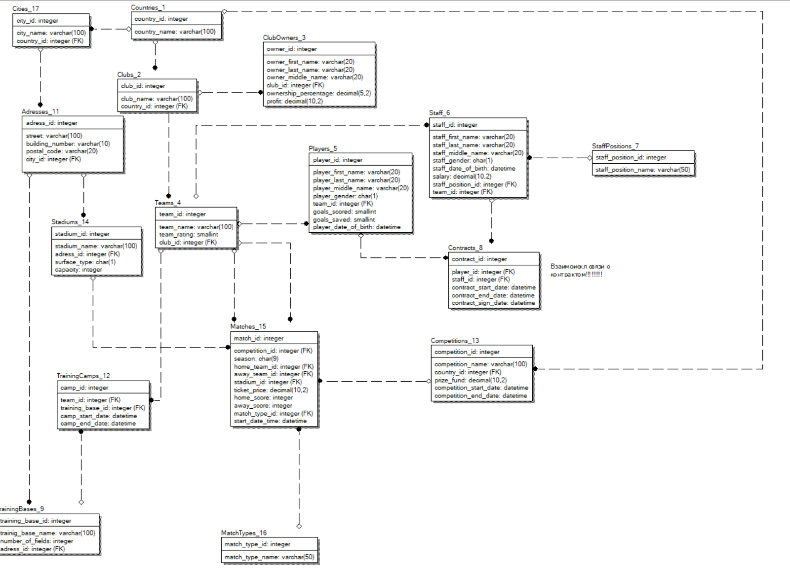

# DB-university-course

Тут собраны все мои лабы по базам данных.

## Общая формулировка для проектирования модели данных
База данных сети футбольных клубов.

Спроектировать базу данных международной сети футбольных клубов. Каждый клуб располагается в конкретной стране, имеет название и несколько команд (дивизионов). В БД необходимо хранить фамилию, имя, отчество владельцев клубов, а также процент владения и прибыль, получаемую с каждого клуба. Каждая футбольная команда имеет название и рейтинг. 

Информация о футболистах включает в себя фамилию, имя, 
отчество, пол, дату рождения, количество забитых или отбитых 
мячей. Среди персонала, работающего с футбольной командой, 
есть тренеры, массажисты, врачи и т. д. Данные персонала: фами
лия, имя отчество, пол, дата рождения, должность, зарплата. Как с футболистами, так и с персоналом, работающим с командой, заключаются контракты (дата начала, дата конца, дата заключения, уникальный номер).    

Клуб может организовывать сборы для своих команд и ко
манд других клубов на разных тренировочных базах. Необходимо 
фиксировать даты начала и конца сборов, информацию о трениро
вочных базах: название, адрес, количество футбольных полей и т. п.    

Кроме того, в БД должна храниться информация о футболь
ных соревнованиях (сроки, название, тип, призовой фонд, место 
проведения соревнования). Расписание соревнования содержит 
данные о матчах (номер матча, дата и время начала матча, играю
щие команды, сезон, тип матча), местах проведения матчей (на
звание стадиона, адрес, тип покрытия, количество мест). Для каждого матча необходимо фиксировать цену билета, количество 
проданных билетов, погодные условия, счет матча.

## Схема данных
